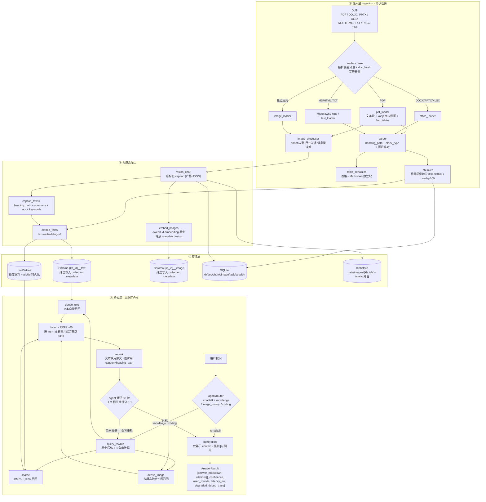

# mmkb 设计稿

> 通用多模态知识库问答系统。用户可创建任意数量的知识库，导入任意领域的文档与图片，
> 系统自动完成解析、向量化、检索与带引用的问答。
>
> **本文件是 Batch 1–8 的施工契约。** 任何实现与本文不符，以本文为准；确需变更时同步改本文。

---

## 0. 已确认的硬约束

| # | 事项 | 结论 |
|---|---|---|
| 1 | 生成模型 | **`deepseek-flash`**，OpenAI 兼容 SDK，`base_url=https://api.deepseek.com`。原生支持**图像输入**（标准 `image_url` content part），支持思考模式、1M 上下文、流式输出。**不支持视频输入，不实现视频链路。** |
| 2 | `reasoning_effort` | 字符串枚举 **`low` / `high` / `max` / `none`**，默认 **`high`**（即思考模式默认开启），`none` 表示关闭。**不是整数 1–100。** |
| 3 | 文本向量 | DashScope `text-embedding-v4`（走 compatible-mode），备选 SiliconFlow `BAAI/bge-m3`。 |
| 4 | 多模态向量 | DashScope **`qwen3-vl-embedding`**，维度档位 **2560(默认) / 2048 / 1536 / 1024 / 768 / 512 / 256**，`enable_fusion=true` 开启图文融合空间。请求体用 `input.contents` 数组，响应取 `output.embeddings[0].embedding`。 |
| 5 | 多模态端点 | **必须调原生 API**：`POST https://dashscope.aliyuncs.com/api/v1/services/embeddings/multimodal-embedding/multimodal-embedding`。**OpenAI 兼容模式不支持多模态 embedding，禁止用 OpenAI SDK 调这个端点。** |
| 6 | 中文分词 | BM25 中文走 **jieba**，英文走正则小写分词，策略由 `BM25_TOKENIZER` 切换。否则整句退化成单个 token，BM25 路失效。 |

### ⚠️ 向量空间三条铁律（违反则相似度计算无意义）

```
铁律 1  文本查文本：query 用 text-embedding-v4 编码 → 检索 {kb_id}__text
铁律 2  以文搜图：query 文本送进 qwen3-vl-embedding 原生端点（text-only 输入），
        enable_fusion 与图片入库时【完全一致】→ 检索 {kb_id}__image
铁律 3  禁止混用：不得用 text-embedding-v4 的 query 向量查图像库；
        不得用 qwen3-vl-embedding 的向量查纯文本库。
        两者不是同一个向量空间，直接算余弦相似度是错的。
```

`app/retrieval/dense_image.py` 顶部必须有显式注释：

```python
# 以文搜图的 query 必须走多模态融合空间，不能用 text-embedding-v4 编码。
```

### 已知限制（正面记录，不回避）

- **reranker 只吃文本，无法理解图像。** `gte-rerank` / `bge-reranker-v2-m3` 均为纯文本交叉编码器。
  因此图片类召回结果一律用 **caption 文本 + 章节路径** 参与重排（模板 `RERANK_IMAGE_DOC_TEMPLATE`）。
  这是明确取舍，其精度损失由 Batch 8 的消融组 `hybrid_rrf` vs `hybrid_rrf_rerank` 量化。
- DeepSeek 官方 API **没有任何 embedding 端点**，调用会 404，向量一律外挂 provider。
- 图片 caption 生成是导入链路的主要耗时来源（并发 4 时约 1.5–6 s/张）。

---

## 1. 整体架构



### 降级矩阵

| 故障 | 降级动作 | 标记 |
|---|---|---|
| 多模态 embedding 不可用 | 图片不进 `__image`，仅保留 caption 走文本链路 | `degraded_reasons += ["image_embed_unavailable"]` |
| Vision caption 不可用 | `caption_source="context_only"`，用 anchor chunk 前后 800 字合成描述 | `["vision_unavailable"]` |
| rerank 不可用 | 直接用 RRF 分数排序 | `["rerank_unavailable"]` |
| LLM judge 不可用 | 跳过第二轮，直接用第一轮结果生成 | `["judge_unavailable"]` |
| BM25 索引缺失 | 就地重建；仍失败则跳过该路 | `["bm25_unavailable"]` |
| 生成模型不可用 | 返回 top-k 原文 + citations，`answer_markdown` 为提示语 | `["llm_unavailable"]` |
| 有资料但答案未标任何 `[n]` | 如实返回答案，不伪造引用；置信度按零覆盖率计算 | `["citation_missing"]` |

---

## 2. 目录结构

```
mmkb/
├── app/
│   ├── main.py                          # ✅ Batch 7  FastAPI 装配 / lifespan / 静态挂载 / 异常处理器
│   ├── config.py                        # ✅ Batch 1
│   ├── core/
│   │   ├── schemas.py                   # ✅ Batch 2  六大领域模型 + AnswerResult / DebugTrace
│   │   ├── logging.py                   # ✅ Batch 2  结构化 JSON 日志 + timing 打点
│   │   ├── ids.py                       # ✅ Batch 1  kb_/doc_/ck_/img_/task_ 前缀 ID
│   │   ├── errors.py                    # ✅ Batch 2  异常层级 + ConfigurationError 再导出
│   │   ├── cache.py                     # ✅ 性能优化  TTL + LRU 缓存 + 长度前缀键 + 命中率统计
│   │   ├── perf.py                      # ✅ 性能优化  进程内指标登记表（最近 2048 样本 / 最近秩分位）
│   │   └── tokens.py                    # ✅ Batch 1  tiktoken token 计数
│   ├── providers/
│   │   ├── base.py                      # ✅ Batch 2  LLMProvider / EmbeddingProvider / RerankProvider
│   │   ├── http_util.py                 # ✅ Batch 2  httpx 客户端 + 统一错误翻译
│   │   ├── embedding_base.py            # ✅ Batch 2  HTTP embedding 基类 + 维度断言
│   │   ├── deepseek_llm.py              # ✅ Batch 2  chat / chat_stream / vision_chat
│   │   ├── dashscope_embedding.py       # ✅ Batch 2  文本(compatible) + 图像(原生 HTTP)
│   │   ├── siliconflow_embedding.py     # ✅ Batch 2  BAAI/bge-m3
│   │   ├── rerank.py                    # ✅ Batch 2  DashScope + SiliconFlow 重排
│   │   └── factory.py                   # ✅ Batch 2  装配 + 启动期维度断言
│   ├── store/
│   │   ├── models.py                    # ✅ Batch 3  SQLAlchemy 2.x ORM + UTCDateTime
│   │   ├── db.py                        # ✅ Batch 3  Database + WAL/foreign_keys pragma
│   │   ├── docstore.py                  # ✅ Batch 3  异步 CRUD + 级联删除 + 幂等 upsert
│   │   ├── vectorstore.py               # ✅ Batch 3  抽象接口 + 铁律 3 的空间守卫
│   │   ├── vectorstore_chroma.py        # ✅ Batch 3
│   │   ├── vectorstore_pg.py            # ✅ Batch 3  PostgreSQL + pgvector（惰性导入）
│   │   ├── bm25store.py                 # ✅ Batch 3  jieba/正则分词 + 索引缓存 + 落盘
│   │   ├── blobstore.py                 # ✅ Batch 3  图片落盘 / URL / 路径穿越防护
│   │   └── factory.py                   # ✅ Batch 3  build_*（纯函数）+ get_*（零参单例）
│   ├── ingestion/                       # ✅ Batch 4
│   │   ├── loaders/{base,pdf_loader,office_loader,markdown_loader,
│   │   │            html_loader,image_loader,text_loader}.py
│   │   ├── parser.py                    # Block 归一化 + 标题层级 + 图片锚定
│   │   ├── table_serializer.py
│   │   ├── image_processor.py           # phash(numpy DCT) / 过滤 / caption / 双向量化
│   │   ├── chunker.py
│   │   └── pipeline.py
│   ├── retrieval/                       # ✅ Batch 5
│   │   ├── base.py                      # 共享结构 + canonical_identity + 快照守卫
│   │   ├── dense_text.py                # 铁律 1
│   │   ├── dense_image.py               # 铁律 2（query 走多模态融合空间）
│   │   ├── sparse.py                    # BM25 + 过滤条件收窄
│   │   ├── fusion.py                    # RRF
│   │   ├── hybrid.py                    # 三路并行 + 汇合 + 降级
│   │   ├── rerank.py                    # 图片用 caption+章节路径参与重排
│   │   └── query_rewrite.py             # 多查询改写（失败退回原问题）
│   ├── agent/                           # ✅ Batch 6
│   │   ├── tools.py                     # 意图 → 检索工具/路由的声明式映射
│   │   ├── router.py                    # 规则优先的四类意图 + 多轮历史压缩
│   │   ├── graph.py                     # 路由 → 检索 → judge → 生成（≤2 轮）
│   │   └── prompts.py                   # 路由 / judge / 历史压缩提示词 + 宽容 JSON 解析
│   ├── generation/                      # ✅ Batch 6
│   │   ├── answer.py                    # 上下文预算 / 引用反解析 / 置信度 / 降级 / 流式
│   │   └── prompts.py                   # 答案与寒暄提示词、context 编号拼装
│   ├── services/                        # ✅ Batch 7  承载层：路由只做参数校验
│   │   ├── container.py                 # 进程单例：配置/DB/存储/provider/agent 唯一装配点
│   │   ├── kb_service.py                # 建库 + 两阶段删除 + 启动续删
│   │   ├── ingest_service.py            # 上传落盘 + 后台任务 + 进度心跳
│   │   ├── chat_service.py              # 会话/历史顺序 + Agent 调用 + 消息落库
│   │   ├── search_service.py            # 原始混合检索 + 以图搜图（独立于文本检索器）
│   │   ├── health_service.py            # 自检快照 + 中断任务恢复
│   │   ├── perf_service.py              # 性能快照：指标/缓存/存储/任务 → JSON + Markdown 同源渲染
│   │   └── eval_service.py              # 未实现：评测为纯 CLI（见 Batch 8 取舍）
│   ├── api/                             # ✅ Batch 7
│   │   ├── deps.py  dto.py  handlers.py  sse.py
│   │   ├── routes_kb.py  routes_ingest.py  routes_chat.py  routes_health.py
│   │   ├── routes_perf.py               # GET /performance · /report · POST /reset · /cache/clear
│   │   └── routes_eval.py               # 未实现：评测为纯 CLI（见 Batch 8 取舍）
│   └── eval/{dataset,metrics,ablation,report,run_eval}.py   # ✅ Batch 8（报告含检索延迟分位）
├── frontend/streamlit_app.py            # ✅ Batch 8  单文件：问答 / 知识库 / 检索诊断 / 性能
├── data/{raw,processed,images,chroma,eval,logs,bench}/   # 运行时数据，.gitignore
├── tests/                               # conftest + 13 个测试模块（含 test_perf / test_benchmark）
├── scripts/{ingest_cli,search_cli,check_providers,show_config,benchmark,launch}.py
├── start.bat  start.sh                  # 一键启动：建 venv / 装依赖 / 转交 launch.py
├── Dockerfile  docker-compose.yml  .dockerignore  .gitignore
├── pyproject.toml  .env.example  DESIGN.md  README.md
```

`data/` 下所有目录由 `PathSettings.ensure()` 在启动时创建，仓库里只保留 `.gitkeep`。

`start.bat` / `start.sh` 只负责「找 Python → 建 `.venv` → 缺依赖时安装」，真正的编排在
`scripts/launch.py`：为 API 与前端各自建立独立进程组、按前缀合并日志、默认端口被占用时
顺延、用 `/api/health` 与 TCP 探测就绪、把 SIGINT / SIGTERM / SIGBREAK 统一归一到
`finally` 的清理路径。前端拿到的 `MMKB_API_BASE` / `MMKB_PUBLIC_BASE` 由实际 API 端口反推，
不需要用户手工改环境变量。

**与初版设计的偏差（已实现，以此为准）：**

| 设计稿 | 实际 | 原因 |
|---|---|---|
| `dashscope_rerank.py` + `siliconflow_rerank.py` | 合并为 `rerank.py` | 两者共用同一套分片 / 并发 / 全局合并再截断逻辑，只有请求体形状不同；拆成两个文件会把 90% 的代码复制一遍 |
| 无 | 新增 `http_util.py` | `AsyncClient` 构造与 HTTP 错误→MMKB 错误翻译被 LLM 之外的所有 provider 共用 |
| 无 | 新增 `embedding_base.py` | 文本 / 图像 / SiliconFlow 三个 embedding 实现的批量分片、维度断言、L2 归一化完全一致，抽成基类后子类只剩「怎么拼请求体」 |
| `app/core/ids.py`、`tokens.py` | 归入 Batch 1 | 是纯函数工具，无外部依赖，配 `show_config.py` 一起验证更自然 |
| `app/core/console.py` | 新增 | Windows 控制台默认不开启 VT 处理，`\033[31m` 会**原样打印**成 `[31m`。`enable_ansi()` 用 ctypes 调 `SetConsoleMode` 打开，非 tty / `NO_COLOR` 时自动降级为无颜色 |
| `app/store/db.py` 归入 Batch 3 | 与 `models.py` 同批 | 两者必须一起验证：`PRAGMA foreign_keys=ON` 写在 `db.py`，而级联删除的 `ondelete="CASCADE"` 写在 `models.py`；分开交付会出现「表结构对了但级联不生效」这种看着都对的中间态 |
| `store/factory.py` 拆成 `build_*` + `get_*` | 见下 | `lru_cache` 要求参数可哈希，而 pydantic `BaseSettings` 不可哈希。`get_vectorstore(settings)` 会直接抛 `TypeError: unhashable type: 'Settings'` |
| BM25 覆盖 `rank_bm25` 的 idf 公式 | 见下 | `BM25Okapi` 的 Robertson idf 在小语料上会**全体归零**，导致刚建好的知识库 BM25 路静默失效 |
| pytest 默认 `tmp_path` 目录 | 固定 `--basetemp=.pytest_run` | Windows 上默认清理路径依赖 `pytest-current` 符号链接；无开发者模式/管理员权限时清理抛 `WinError 5`，把整份测试报告吞掉。目录名先后换过 `.pytest_work` / `.pytest_tmp` / `.pytest_work`：`.pytest_tmp` 一旦被其他用户创建过，ACL 会让当前用户无法删除，会话启动即 `PermissionError`；`.pytest_work` 在本机也复现了同样的 ACL 锁死。`.pytest_run` 是第三次改名，已验证连续两轮全量测试可重复 |
| `app/services/eval_service.py` + `app/api/routes_eval.py` | 不提供；评测只有 CLI `python -m app.eval.run_eval` | 评测是长任务（五组消融 × 全量题 + 生成判定），一次跑几分钟到几十分钟，不适合 HTTP 请求生命周期；它还要写 `report.md` / `report.json` / 图，并读取用户指定路径的数据集。做成 Web 接口等于给任意路径读取开一个入口，收益只有「能在 /docs 里点一下」 |
| Batch 8 目录树中的 `routes_eval.py` / `eval_service.py` | 保留占位注释，不创建空文件 | 空模块会被误认为「接口只是没接」；明确写「未实现 + 原因」比留一个 `NotImplementedError` 更清楚 |
| 无 | 新增 `start.bat` / `start.sh` / `scripts/launch.py` | 初版是「开两个终端分别起服务」，演示时容易漏步骤；端口被占用后前端还会指向旧端口。启动器把建 venv、装依赖、选空闲端口、就绪探测、Ctrl+C 清理收成一个动作。编排放在 Python 里，bat/sh 只做解释器引导，避免两套平台各写一份进程管理 |

**Batch 4 测试暴露并修掉的两个真实 bug：**

| 位置 | 症状 | 根因 |
|---|---|---|
| `loaders/markdown_loader.py` | Windows 上带 front matter 的 `.md`，标题变成 `title: ...`，第一个分块也是垃圾 | `Path.write_text` 落盘是 CRLF，而 front matter 正则只认 `\n`；未剥离的 `---` 被 CommonMark 当成 setext 二级标题下划线 |
| `loaders/office_loader.py` | DOCX 里所有图片丢失，且无任何报错 | Word 插图最常见的形态是「图片独占一个段落」，此时 `paragraph.text == ""`；旧代码在收集图片**之前**就 `continue` 了 |

**Batch 5 的实现要点与取舍：**

| 主题 | 做法 | 原因 |
|---|---|---|
| 图片的同一性 | `canonical_identity`：`image_caption` 分块在文本空间归一为 `item_id = image_id` | 同一张图会被 BM25 / 文本向量（caption）/ 图像向量三路各捞到一次；不归一就会在 RRF 里占三个坑，把真正的文本结果挤下去 |
| 空库不花钱 | 每路先 `probe(kb)`，`collection.count() == 0` 直接跳过 | `--no-embed` 导入的库没有向量数据；不先探针就会为一堆注定为空的结果白付 embedding 调用 |
| 不可降级 vs 可降级 | 快照 / 维度 / 空间不一致抛 `RetrievalError`；单路网络失败记 `RouteResult.error` + 降级原因 | 前者是「配置错了」，继续跑只会返回一批错误的结果；后者是「这一路暂时没用」，其余两路仍能给出正确答案 |
| 多查询融合 | 每条改写查询独立跑三路，RRF 标签带 `#N`，权重 0.7（`REWRITE_WEIGHT`） | 改写查询只用于扩大召回，不应该与用户原话等权；标签带序号是为了在 `--debug` 里能看出某条结果来自哪条改写 |
| 重排失败 | 回退 RRF 顺序 + `RERANK_UNAVAILABLE` | 重排是「让好结果更靠前」，不是「让结果存在」 |
| BM25 过滤 | 只下推 `doc_id` / `block_type`；按图片类型过滤时排除 caption 分块 | 与 `to_chroma_where(space="text")` 保持同一语义 —— 两个通道对同一个筛选条件给出不同结果集会让人怀疑整个系统 |
| CLI 名次展示 | 名次来源放在「路线」列（`bm25:1 dense_image:2`），不放标题列 | 标题列有固定截断宽度，尾部追加的名次会被切掉，而那正是 `--debug` 唯一有诊断价值的信息 |

**Batch 6 的实现要点与取舍：**

| 主题 | 设计稿 | 实际 | 原因 |
|---|---|---|---|
| 编排方式 | LangGraph 流程图 | 普通 `async` 函数 + 显式 `for round_no in range(1, max_rounds+1)` | 这条流程节点固定、分支固定、最多两轮，是**确定性**的。图框架带来的是一层需要理解的抽象和一个新依赖，换不到任何东西；而 `debug_trace` 的完整记录反而更容易写 |
| 引用来源 | 模型输出 JSON `{answer_markdown, citations[], confidence}` | 模型输出纯 Markdown，代码扫描正文 `[n]` 反解析 citations | ① 正文 `[n]` 与引用列表**不可能不一致**，杜绝「点不开的编号 / 正文没引用的来源」；② JSON 在流式生成到一半时无法解析，反解析让 SSE 与一次性回答共用同一套提示词；③ 引用由确定性代码产生，单测无需模拟模型行为 |
| 置信度 | 模型自评 | `0.6×judge分 + 0.3×引用覆盖率 + 0.1(重排生效)`，无 judge 时相关性项取 0.6 | 模型对「自己编没编」的判断并不可靠；覆盖率 = `cited / min(available, 4)`，只引一条的长答案应当被扣分 |
| 引用缺失 | 未单列 | 新增 `DegradedReason.CITATION_MISSING` | 「没有引用可用」与「模型没遵守引用约束」对使用者含义完全不同，后者必须能被统计出来 |
| 取哪一轮结果 | 最后一轮 | **历次判定分最高的一轮**（分数相同取较早一轮） | 第二轮换了 query 可能更差；用最后一轮会让一次失败的改写把本来能回答的资料丢掉 |
| 代码块里的 `[n]` | 未提 | 解析前剔除围栏代码块与行内代码 | `arr[1]`、`x[2]` 是下标，不剔除会凭空多出一条「来源」 |
| 上下文预算 | 按条数截断 | 按字符预算，只保留**完整参与编号**的条目；条目过长时截断正文而非丢弃 | 被截掉的条目不编号，因此不会出现「答案引用 [9] 但引用列表只有 8 条」；半条资料通常仍有用 |
| 寒暄 | 走检索 | 直接生成，`used_rounds=0` | 寒暄没有检索价值；跑三轮召回再让模型说「你好」纯属浪费延迟与费用 |
| 以图搜图 | 只跑图像向量 | 图像向量 + BM25 | 图片 caption 在文本空间里是一个分块，图内文字（型号、错误码）靠 BM25 精确匹配最稳 |
| 判定不可用 | 未提 | 立即停止重检，用本轮结果，记 `judge_unavailable` | judge 挂了就无法判断「换 query 会不会更好」，再跑一轮是赌博 |
| 生成不可用 | 返回提示语 | 返回「生成模型暂时不可用」+ top-k 资料原文 + 完整引用 | 有原文可读比一句「服务不可用」有用；引用列表仍然可点回来源 |

**Batch 7 的实现要点与取舍：**

| 主题 | 做法 | 原因 |
|---|---|---|
| 依赖装配 | `AppContainer` 进程单例；路由 → service → container，`Depends(get_container)` 取用 | 后台任务、provider、DB 只有一个创建点和一个关闭点；测试用 `create_app(settings, container_factory=...)` 注入临时目录与假 provider |
| dev 缺 Key | 降级启动，`/api/health` 报 `not_ready`，只有相关接口 503 | 把「配置问题」与「代码问题」分开：没有 Key 的人也应该能打开 `/docs`；`APP_ENV=prod` 仍由 `require_ready()` 拒绝启动 |
| 健康检查 | `/api/health` 永远 200；`/api/health/ready` 未就绪时 503 | 存活（进程在不在）与就绪（能不能接流量）是两件事，编排系统需要后者 |
| SSE 心跳 | 挂起 `Task` + `asyncio.wait(timeout)`，超时才发 `: ping` | `asyncio.wait_for(anext(...))` 超时会取消 `anext`，进而关闭 async generator；一次心跳就会截断整条回答 |
| 流式预检 | 返回 `StreamingResponse` 之前先 `require_kb` + `require_agent` | 响应头一旦发出就无法改回 404/503 的 JSON |
| 流式落库 | 正常收到 `done` 后才写 assistant 消息；客户端断开只留 user 消息 | `GeneratorExit` 时 await 数据库写入不可靠；留下的 user 消息足以说明「问过但没完成」 |
| 两阶段删库 | 先标 `deleting` → 清向量/BM25/图片 → 删元数据；启动时续删 | `kill -9` 不会留下「元数据没了但向量还在」的半个库；失败的库仍可见，不会被误认为正常 |
| 中断任务恢复 | 启动时把 `queued/running` 任务标为 `FAILED` 并写明原因 | 执行者已经不存在，继续显示「解析中」会永久转圈 |
| 上传语义 | 先校验扩展名再读字节；返回 `202 + Task`，后台导入 | 200 MB 的 `.mp4` 不值得先读进内存；解析/向量化本来就不该占住请求 |
| 错误信封 | HTTP 与 SSE `error` 事件共用 `{"error": {code, message, detail}}` | 前端只写一次错误处理；流式与非流式的失败语义一致 |
| 路由自省 | 以 `app.openapi()["paths"]` 或实际请求验证，不遍历 `app.routes` | FastAPI 0.143 把 include 进来的子路由表示为延迟展开的 `_IncludedRouter`（无 `path` 属性）；按旧版方式遍历会误判「路由全丢了」 |

**Batch 8 的实现要点与取舍：**

| 主题 | 做法 | 原因 |
|---|---|---|
| 评测入口 | 纯 CLI，不暴露 `POST /api/eval/run` | 见上表：长任务 + 写文件 + 任意路径读取，HTTP 化只有风险没有收益 |
| 未标注用例 | `labeled=false` 或缺 `ground_truth` 的题直接跳过，指标返回 `None`，报告里显示 `—` | 空标注不是 0 分。把它算成 0 会凭空拉低每个消融组，而且无法区分「没找到」与「没标注」 |
| 指标实现 | Recall / MRR / nDCG / Context Precision 全部自实现，单测覆盖去重与 k 截断；RAGAS 只作为可选增强 | 确定性指标不需要模型，离线可验证；RAGAS 是重依赖，缺了就降级，不让它成为跑通评测的前提 |
| 生成评测范围 | 只对 `--generation-group` 指定的**一组**跑生成与 LLM judge | 五组各跑一遍生成会让费用和耗时直接乘五，而生成质量主要由线上配置（`hybrid_rrf_rerank`）决定 |
| 图搜图评测 | 直接编码查询图 → `{kb}__image`，绕开文本检索器；先 `guard_kb_snapshot(space="image")` | 评测需要量化图搜图，但不能为了评测在检索层开一个线上不用的文本入口；空间守卫必须和线上一致 |
| 评测单元 | 图片任务只认 `image_id`；文本任务若标注了 `doc_ids`，同一文档的多个分块折叠成一个单元 | caption 分块命中不等于找到了图；不折叠文档会让一篇相关文档占满前 10 名，Recall 虚高 |
| 配置级错误 | `_run_group` 对 `RetrievalError` 直接向上抛，不按题记录 | 快照不一致对每道题都一样，继续跑只会重复报错、白花 embedding 调用，还让「配置错了」看起来像「检索效果差」 |
| 前端以图搜图 | 检索诊断页上传查询图 → `POST /api/search/image`，结果直接渲染原图 | 这是产品卖点之一；接口已具备快照守卫，且明确标注「重排不参与」 |
| 前端图片 URL | `MMKB_API_BASE`（容器到 API）与 `MMKB_PUBLIC_BASE`（浏览器到 API）分开 | compose 里容器名 `api` 在浏览器不可解析；图片链接必须用宿主机可达地址 |
| 镜像与密钥 | 只有 `api` 服务读 `.env`；`frontend` 只拿到两个 base URL | 前端不需要任何模型密钥，缩小泄露面 |
| 非根用户 | 镜像内 `appuser` UID 1000；compose 挂载 `./data` | root 写出的数据文件会让宿主机用户无法读写；Linux 上需保证 `data/` 对 UID 1000 可写 |

---

## 3. 数据流转

### 链路 A：导入一张带图 PDF（30 页 / 12 张内嵌图）

| # | 模块 | 动作 | 耗时量级 |
|---|---|---|---|
| 1 | `routes_ingest` → `ingest_service` | 收文件 → `doc_hash=sha256(bytes)` → 查 `(kb_id, doc_hash)`；命中则返回既有 `doc_id`，状态 `skipped_duplicate`（**幂等**） | 20–60 ms |
| 2 | `ingest_service` | 落 `Document(status=queued)` + `Task(queued)`，挂 asyncio 注册表，立即返回 `task_id` | <10 ms |
| 3 | `pdf_loader` | `fitz.open()`；`get_text("dict")` 取 span 的 size/flags 推标题；`find_tables()` 取表；`get_images(full=True)` 取 xref → `extract_image` 拿字节，`get_image_rects(xref)` 拿 bbox，按 `page_no + bbox.y0` 定序 | 0.8–2.5 s |
| 4 | `parser` | 归一化为 `Block[]`（`heading_path`/`block_type`/`page`/`order`）；**把每张图锚定到上方最近的文本块**，写入 `anchor_chunk_id` 候选与 `context_text`（前 800 字） | 30–90 ms |
| 5 | `table_serializer` | 表格 → Markdown，`block_type="table"`，**不进正文切分流**，自成一个原子块 | 20–60 ms |
| 6 | `chunker` | 按 `heading_path` 建树 → 叶子合并到 300–800 token、overlap 100；**code/table 块整体保留**，超限也只按行/语句边界切 | 40–120 ms |
| 7a | `image_processor.filter` | phash(32×32 DCT → 8×8 中位数二值化) 与同库已有图汉明距离 ≤5 判重；任一边 <100px 丢弃；灰度 std < 阈值或唯一色占比过低判为装饰图 | 60–150 ms |
| 7b | `image_processor.caption` | **主瓶颈**。并发 4，`vision_chat`（`deepseek-flash`）输入 = 图 + `heading_path` + `context_text`，输出严格 JSON `{image_type, summary, ocr_text, relation_to_section, keywords[]}`。重试 3 次仍失败 → `caption_source="context_only"` | **5–20 s** |
| 7c | `blobstore.put` | 原图写 `data/images/{kb_id}/{image_id}.{ext}`，URL `/static/images/{kb_id}/{image_id}.{ext}` | 10–40 ms |
| 8a | `embed_images` | 12 张在融合模式下**逐条**请求（实测 `enable_fusion=true` 时端点会把整批 contents 融成 1 个向量；只有 `false` 才按 `IMAGE_EMBED_BATCH_SIZE` 分片）→ 原生端点 → 断言 `len(vec)==image_embed_dim` → upsert `{kb}__image` | 0.8–2 s |
| 8b | `embed_texts` | chunk 文本（≈120 条）+ caption_text（12 条），按 `TEXT_EMBED_BATCH_SIZE` 分片，每片独立重试 | 1.5–4 s |
| 9 | 落库 | docstore 批量写 chunk/image；`{kb}__text` upsert；bm25store 追加语料并重建 | 0.2–0.6 s |
| 10 | `ingest_service` | `Document(status=done)` + 计数 + `Task(done)`；任一阶段异常 → 回滚该 doc 的向量与图片，`status=failed` + `error` | <50 ms |
| | | **合计（端到端异步）** | **≈ 8–28 s** |

进度通过 `GET /api/kb/{kb_id}/tasks/{task_id}` 轮询，返回 `stage / progress_current / progress_total / stage_timings`。

### 链路 B：用户提问

| # | 模块 | 动作 | 耗时 |
|---|---|---|---|
| 1 | `routes_chat` → `chat_service` | 校验 kb 存在、按 `session_id` 取历史（超 `HISTORY_COMPRESS_TRIGGER_CHARS` 则压缩） | <10 ms |
| 2 | `agent/router` | 规则优先（"这张图/类似图片"→image_lookup；纯寒暄→smalltalk；含代码→coding），不确定才调 LLM。**smalltalk 直接生成，不走检索** | 0 或 400–900 ms |
| 3 | `query_rewrite` | ① 历史 + 当前问题 → 压缩为独立可检索 query；② 生成 3 个不同角度改写 | 600–1500 ms（可关） |
| 4 | 三路**并行**召回 | · `dense_text`：`embed_texts(query)` → `{kb}__text`<br>· `sparse`：jieba 分词 → BM25<br>· `dense_image`：query 文本送**多模态原生端点**（text-only，同 `enable_fusion`）→ `{kb}__image`<br>各取 `TOP_K_PER_ROUTE`，带 `filters` 在存储层过滤 | **150–400 ms** |
| 5 | `fusion.rrf` | `score(d)=Σ wᵢ·1/(k+rankᵢ(d))`，`k=60`，按 `item_id` 去重，保留每路 rank 与原始分 | <5 ms |
| 6 | `rerank` | top-50 → top-8。文本块用原文；**图片用 caption + heading_path** | 200–700 ms |
| 7 | `agent.graph` judge | LLM 对 top-8 与问题逐条打 0–1 分 + 理由。最高分 < `RELEVANCE_THRESHOLD` → 用改写 query 重检（**最多 2 轮**） | 700–2000 ms |
| 8 | `generation.answer` | 拼 `<context>[1]..[n]`，强约束：只用 context / 关键结论必带 `[n]` / 无依据必须回「知识库中未找到相关内容」/ 用自身知识必须标注「以下不属于知识库内容」。模型输出**纯 Markdown**，引用由正文里的 `[n]` 反解析 | 首 token 400–1200 ms，全文 2–8 s |
| 9 | 组装 | citations 由 `[n]` 回填完整 provenance（doc_name / page / heading_path / **image_url**）；置信度按「judge 分 + 引用覆盖率 + 是否重排」计算；写 `debug_trace` | <10 ms |
| | | **合计** P50 ≈ **2.5–4 s**；触发第二轮 ≈ 6–9 s |

`debug_trace` 每轮一条：

```json
{"round":1,"query":"...","rewrites":["...","...","..."],
 "candidates":{"bm25":20,"dense_text":20,"dense_image":20,"fused_unique":47},
 "reranked":8,"judge":{"score":0.78,"reason":"...","threshold":0.6,"passed":true},
 "timings_ms":{"rewrite":940,"dense_text":213,"bm25":18,"dense_image":206,
               "fusion":3,"rerank":412,"judge":1180}}
```

---

## 4. 数据 Schema

### 4.1 `KnowledgeBase`

```python
kb_id: str                          # "kb_" + uuid4().hex[:12]，主键
name: str                           # 1..64，唯一
description: str = ""
status: Literal["active", "deleting"] = "active"
created_at: datetime                # UTC aware
updated_at: datetime

text_collection: str                # f"{kb_id}__text"
image_collection: str               # f"{kb_id}__image"

text_dim: int                       # 建库时快照自 settings.text_embed.dim
image_dim: int                      # 建库时快照自 settings.image_embed.dim
llm_model: str                      # ┐
text_embed_model: str               # │ 建库时的模型快照，
image_embed_model: str              # │ 用于检测「换了模型导致向量空间漂移」
rerank_model: str                   # ┘

doc_count: int = 0
chunk_count: int = 0
image_count: int = 0
```

### 4.2 `Document`

```python
doc_id: str                         # "doc_" + 12hex
kb_id: str                          # FK → KnowledgeBase，ON DELETE CASCADE
source_path: str
source_name: str
mime_type: str
doc_hash: str                       # 原始字节 sha256；UNIQUE(kb_id, doc_hash) 实现幂等
size_bytes: int
page_count: int | None
title: str | None

status: Literal["queued", "parsing", "captioning", "embedding",
                "indexing", "done", "failed", "skipped_duplicate"]
task_id: str | None
error: str | None                   # 失败摘要，≤2000 字符

chunk_count: int = 0
image_count: int = 0
skipped_image_count: int = 0

extra: dict[str, Any] = {}          # {"sheet_names":[...], "slide_count":8, "lang":"zh"}
created_at: datetime
updated_at: datetime
indexed_at: datetime | None
```

### 4.3 `Chunk`（文本块与图片 caption 共用此结构）

```python
chunk_id: str                       # "ck_" + 12hex
kb_id: str
doc_id: str
ordinal: int                        # 文档内顺序，从 0 起

text: str                           # caption 块存放 caption_text
token_count: int
block_type: Literal["text", "code", "table", "image_caption"]

heading_path: list[str]             # ["第三章 系统设计", "3.2 检索模块"]
page_from: int | None               # 1-based
page_to: int | None
image_ids: list[str]                # image_caption 块必含 1 个

prev_chunk_id: str | None
next_chunk_id: str | None
source_ref: dict[str, Any] = {}     # {"sheet":"Sheet1"} / {"slide":3} / {"bbox":[..]}
created_at: datetime
```

> `block_type="table"` 的块不参与正文切分，独立成块；超长时只按行边界切并在每片重复表头。

### 4.4 `ImageAsset`

```python
image_id: str                       # "img_" + 12hex
kb_id: str
doc_id: str | None                  # 独立上传的图片为 None
page: int | None
bbox: list[float] | None            # [x0,y0,x1,y1]
order_in_doc: int

file_path: str                      # data/images/{kb_id}/{image_id}.png
url: str                            # /static/images/{kb_id}/{image_id}.png
mime_type: str
width: int
height: int
size_bytes: int

sha256: str                         # 字节级完全重复
phash: str                          # 16 位 hex（8×8 二值指纹）
status: Literal["extracted", "filtered_out", "done", "failed"]
filtered_reason: Literal["small", "blank", "duplicate", "decorative"] | None

caption: ImageCaption | None
caption_text: str = ""
caption_source: Literal["vlm", "context_only", "none"] = "none"
anchor_chunk_id: str | None
context_text: str = ""              # ≤800 字符

text_chunk_id: str | None           # caption 在 __text 中的 chunk_id
image_vector_id: str | None         # __image 中的 id（= image_id）

created_at: datetime
```

```python
class ImageCaption:                 # VLM 严格 JSON 输出
    image_type: Literal["chart", "screenshot", "diagram", "photo",
                        "formula", "table_image", "logo", "other"]
    summary: str                    # 核心内容，1–3 句
    ocr_text: str                   # 图中关键文字，保持阅读顺序
    relation_to_section: str        # 与所在章节的关系
    keywords: list[str]             # 3–8 个检索关键词
    caption_model: str
    caption_latency_ms: int
```

`caption_text` 拼装规则（**文本向量与 rerank 的共同输入**）：

```
"{' > '.join(heading_path)} | [{image_type}] {summary} | 图中文字: {ocr_text} | 关键词: {', '.join(keywords)}"
```

### 4.5 `RetrievedItem`

```python
item_id: str                        # chunk_id 或 image_id，去重键
item_type: Literal["text", "code", "table", "image"]
kb_id: str
doc_id: str
chunk_id: str | None
image_id: str | None

text: str                           # 送 rerank/生成；图片 = caption_text
score: float
route: Literal["bm25", "dense_text", "dense_image", "hybrid"]
route_scores: dict[str, float]      # {"bm25":3.21, "dense_text":0.81, "dense_image":0.63}
route_ranks: dict[str, int]         # {"bm25":1, "dense_text":4, "dense_image":9}
rrf_score: float
rerank_score: float | None

heading_path: list[str]
page: int | None
source_name: str
image_url: str | None
metadata: dict[str, Any] = {}
```

### 4.6 `Citation`

```python
index: int                          # 对应答案中的 [n]，从 1 起
item_id: str
item_type: Literal["text", "code", "table", "image"]
doc_id: str
doc_name: str
page: int | None
heading_path: list[str]
snippet: str                        # ≤300 字符；图片为 caption 摘要
image_url: str | None               # 非空时前端渲染 
image_id: str | None
score: float
rerank_score: float | None
```

### 4.7 辅助结构

```python
class AnswerResult:                 # POST /api/chat 响应体
    answer_markdown: str
    citations: list[Citation]
    confidence: float
    used_rounds: int
    latency_ms: int
    degraded: bool = False
    degraded_reasons: list[str] = []
    debug_trace: list[RoundTrace]
    session_id: str

class Task:
    task_id: str                    # "task_" + 12hex
    kb_id: str
    doc_id: str | None
    status: Literal["queued","running","done","failed","cancelled"]
    stage: str                      # parsing / captioning / embedding / indexing
    progress_current: int
    progress_total: int
    stage_timings: dict[str, int]
    error: str | None
    created_at: datetime
    finished_at: datetime | None

class Session / Message:
    session_id: str; kb_id: str; created_at: datetime
    message_id: str; role: Literal["user","assistant"]; content: str
    citations: list[Citation] | None; created_at: datetime
```

---

## 5. API 契约

| 方法 | 路径 | 说明 |
|---|---|---|
| `GET` | `/api/health` | 存活 + 配置/存储/能力自检，**永远 200** |
| `GET` | `/api/health/ready` | 就绪探针，`not_ready` 时 503 |
| `GET` / `POST` | `/api/kbs` | 列出 / 创建知识库（同名 409） |
| `GET` / `DELETE` | `/api/kbs/{kb_id}` | 详情 / 两阶段级联删除 |
| `POST` | `/api/kbs/{kb_id}/ingest` | multipart 上传，异步，返回 `202 + Task` |
| `GET` | `/api/tasks/{task_id}` | 导入进度 |
| `GET` | `/api/kbs/{kb_id}/tasks` | 知识库的任务列表 |
| `GET` | `/api/kbs/{kb_id}/documents` | 文档列表（可按状态过滤） |
| `GET` | `/api/documents/{doc_id}` | 文档详情 |
| `POST` | `/api/chat` | `{kb_id, question, session_id?, top_k?, use_rerank?, rewrite?, debug?}` → `AnswerResult` |
| `POST` | `/api/chat/stream` | SSE：`meta` → `token`/`reasoning` → `citations` → `done`（失败发 `error`） |
| `GET` | `/api/sessions/{session_id}/messages` | 会话历史 |
| `DELETE` | `/api/sessions/{session_id}` | 删除会话 |
| `POST` | `/api/kbs/{kb_id}/search` | 原始混合检索（含每路诊断信息） |
| `POST` | `/api/search/image` | multipart（`file` + `kb_id` + `top_k`）：以图搜图，直接查 `{kb}__image`，不经过文本检索器、不重排 |
| `POST` | `/api/eval/run` | **不提供。** 评测是长任务且要写文件，只保留 CLI：`python -m app.eval.run_eval` |

---

## 6. 八批实施计划

| 批次 | 交付物 | 验收命令 |
|---|---|---|
| **1** | `DESIGN.md`、`pyproject.toml`、`.env.example`、`app/config.py`、`scripts/show_config.py`、`.gitignore`、`.dockerignore` | `python scripts/show_config.py` |
| **2** | `core/*` + `providers/*`（含原生多模态 HTTP 调用）+ `scripts/check_providers.py` + 离线单测 | `python scripts/check_providers.py` / `python -m pytest tests/test_providers.py` |
| **3** | `store/*`：ORM、db、docstore、vectorstore(抽象+chroma+pg)、bm25store、blobstore、factory | `python -m pytest tests/test_store.py` |
| **4** | `ingestion/*` 全部 loaders + parser + table_serializer + image_processor + chunker + pipeline + `scripts/ingest_cli.py` | `python scripts/ingest_cli.py --kb demo --path data/raw --no-embed` |
| **5** | `retrieval/*` 全部 + `scripts/search_cli.py` + RRF 数值单测 | `python scripts/search_cli.py --kb demo --q "..." --debug` |
| **6** | `agent/*` + `generation/*`（含 SSE） | `python scripts/search_cli.py --ask "..."` |
| **7** | `services/*` + `api/*` + `main.py` | `uvicorn app.main:app --reload` → `/docs`、`/api/health` |
| **8** | `frontend/` + `Dockerfile` + `docker-compose.yml` + `eval/*` + `README.md` | `python -m app.eval.run_eval --kb <id> --ablation all`；`streamlit run frontend/streamlit_app.py`；`docker compose up --build` |

### 五组 A/B 消融（Batch 8）

| 组名 | 配置 |
|---|---|
| `bm25_only` | `RETRIEVAL_ENABLE_BM25=true`，其余两路 + rerank 关闭 |
| `dense_text_only` | 仅 `ENABLE_DENSE_TEXT` |
| `dense_image_only` | 仅 `ENABLE_DENSE_IMAGE` |
| `hybrid_rrf` | 三路全开，`RETRIEVAL_ENABLE_RERANK=false` |
| `hybrid_rrf_rerank` | 三路全开 + rerank（默认线上配置） |

指标：文本检索 Recall@5 / Recall@10 / MRR@10 / nDCG@10；跨模态 以文搜图 Recall@5、以图搜图 Recall@5；
生成 Faithfulness / Answer Relevancy / Context Precision（RAGAS 缺失时降级为 `eval/metrics.py` 自实现）。
产物：`data/eval/report.md` + `report.json` + `cases.jsonl` + matplotlib 对比柱状图。

**数据集标注规则（不可由代码代劳）：**

- 每行一个 JSON 对象，字段 `id / task / query / query_image / kb_id / labeled / ground_truth / notes`；
- `task` 为 `text` / `text_to_image` / `image_to_image`；后者的 `query_image` 必须是真实存在的文件；
- `ground_truth` 只填**确实相关**的 ID：文本题用 `item_ids` / `doc_ids`，图片题用 `image_ids`；
- `labeled: true` 且 `ground_truth` 非空才会参与评分；其余计入 `unlabeled_cases` 并跳过；
- `eval/samples/eval_set.example.jsonl` 里的 5 条**全部未标注**，加载后 `labeled_cases == 0` 是预期结果。

### 性能优化与观测（已实现）

**观测**：`app/core/perf.py` 的进程内登记表 + `app/services/perf_service.py` 的快照渲染。
一次 `snapshot()` 同时服务 `GET /api/performance`、`GET /api/performance/report` 与 Streamlit
「性能」页签，JSON 与 Markdown 不存在两套算法。指标窗口固定 2048 样本、最近秩分位，
重启清零这一点在报告里明说，不伪装成持久化监控。

| 优化点 | 做法 | 为什么这样而不是别的 |
|---|---|---|
| query 向量缓存 | `TTLCache`，键含 provider / 模型 / 维度 / 空间 / fusion | 缓存必须与铁律 3 同构；否则「同一个查询、不同空间」会命中同一个键 |
| 重排缓存 | 键含 provider / 模型 / query / 全部候选文本 | 只拿 query 做键会把 A 库的候选分数复用到 B 库；候选文本进键后，导入新内容自然换键，不需要主动失效 |
| collection 元信息缓存 | 短 TTL（默认 30 s），导入/删除时主动失效 | 计数查询在每次路由探测都会发生，但它只用于「空库跳过」 |
| 导入并发 | 批量文件信号量（`INGEST_MAX_CONCURRENT_DOCS`）；单文件内图片检查信号量（`INGEST_IMAGE_INSPECT_CONCURRENCY`）；文本向量与图像向量 `gather` 并行 | 两件互不依赖的外部调用串行没有收益；而无限并发只会把 provider 打到限流 |
| 图片融合向量 | `IMAGE_EMBED_BATCH_SIZE=1`，逐条请求 | `enable_fusion=true` 会把一批 contents 融合成一个向量；这不是性能问题是正确性问题 |
| 检索规划 | 三路 `probe()` 并发，避免「空库判断」串行累加 | 探测只读本地元数据，并发无副作用 |
| 召回执行 | 每个 `(query, route)` 一个 task 并发；RRF 后再统一重排 | 重排是全局排序，必须等三路都汇合；把它塞进每一路会让同一文档被打分多次 |
| 阶段计时 | 每个阶段写 `retrieval.*` / `ingest.stage.*` 指标，同时回填 `timings` / `stage_timings` | 现场报告看指标，离线分析看单次任务的阶段表，两者同源 |
| 基准口径 | 冷/热缓存分离；均值表达阶段占比，p95 不宣称可加 | 阶段并发，和墙钟相加在物理上就不成立 |

**主动不做的**：不引入 Prometheus / OpenTelemetry / 独立监控进程。这个项目的部署形态是
「单进程 + 单机演示」，多一个时序库只会增加启动步骤；进程内指标 + 可复现基准已经能回答
「慢在哪、改完快了多少」。若将来要多副本，再把 `MetricsRegistry` 换成 OTel meter 即可，
调用点（`observe` / `incr`）不需要改。

### 加分项（Batch 8 之后）

1M 上下文直塞 vs RAG 对比实验 · 拒答率/幻觉率看板 · GitHub Actions。
（以图搜图前端交互已在 Batch 8 实现，见 `frontend/streamlit_app.py` 的「检索诊断」页签。）

---

## 7. 关键实现约定

1. **业务代码严禁 import 具体厂商 SDK**（`openai`、`dashscope` 等只能出现在 `app/providers/` 内）。
2. 向量维度、模型名、路径、密钥**全部配置驱动**，不硬编码；启动时断言配置维度 == 实际返回维度，
   不符则抛 `DimensionMismatchError(text_dim=1024, got=768)` 这样的明确错误。
3. 所有外部调用带 timeout + tenacity 重试 + 信号量限流 + **批量分片**。
4. 路由函数只做参数校验与依赖注入，业务逻辑一律在 `app/services/`。
5. 图片 phash 用 numpy 手写 DCT-II 实现，**不引入 `imagehash`/`scipy`/`PyWavelets`**。
6. Chroma 的默认 embedding function（需下载 ONNX 模型）**绝不使用**：所有写入与查询都显式传
   `embeddings=` / `query_embeddings=`，镜像内不下载任何本地模型。
7. SSE 用 FastAPI 原生 `StreamingResponse` 手写，不引入额外依赖。
8. `data/eval/eval_set.jsonl` 的 `ground_truth` **必须人工标注**，代码只提供格式与 5 条示例。
